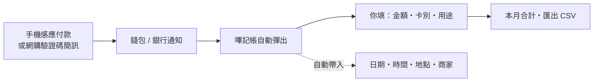

  
  
  
  
  

<b><a href="../../releases/latest">⬇ 下載 Android APK</a></b> · <a href="#english">English</a>

# 嗶記帳 PayLog

手機感應付款（NFC）或網購收到驗證碼簡訊後，自動彈出記帳畫面。
你只填：**消費總值、支付卡（VISA / MASTER / 悠遊卡）、用途**；日期、時間、地點、商家自動帶入。

- **拍下發票 / 收據**：每筆消費可附多張照片（拍照或從相簿選），匯出 ZIP 一起帶走，報帳超方便
- **用途自訂**：除了預設分類，可隨時新增、刪除自己的用途
- 所有紀錄只存在你的手機，不上傳、不需註冊、沒有廣告
- 一鍵匯出 CSV（Excel 直接開啟），或 CSV + 發票照片 ZIP
- 免費、開放原始碼（MIT 授權）

## 運作方式

## 為什麼做這個

手機嗶一下付款很方便，但月底常想不起錢花去哪。一般記帳 App 要自己打開、自己記，很容易忘。
嗶記帳在**付款的那一刻**主動跳出來，三秒記好，不會漏。

## Android 安裝

1. 到 [Releases](../../releases) 下載最新的 `.apk`
2. 手機開啟下載的檔案 → 允許「安裝不明來源的應用程式」→ 安裝
3. 打開嗶記帳，依主畫面提示開啟權限：
   - **付款偵測**（通知存取權）：讀取 Google 錢包、Samsung Wallet、銀行 App 的付款通知
   - **自動彈出**（顯示在其他應用程式上層）
   - **全螢幕通知**：鎖定時也能彈出
   - **簡訊偵測**：網購驗證碼簡訊觸發記帳（可不開）
4. 若開關是灰色按不了（Android 13+）：設定 → 應用程式 → 嗶記帳 → 右上 ⋮ →「允許受限制的設定」
5. 設定 → 「測試：模擬感應付款」，8 秒內回到桌面，確認填寫畫面會自動跳出

小米 / 紅米 / POCO：另需在 應用程式資訊 → 其他權限 開啟「在背景中顯示彈出式視窗」。

> 偵測靠的是付款後錢包 / 銀行 App 發出的通知。電信 SIM 卡型的手機悠遊卡、實體卡通常沒有通知，請用「＋ 記一筆」或下拉選單的「記一筆」快速設定磚手動記錄。

## iPhone

iPhone 版需自行用 Mac + Xcode 建置（Apple 限制，無法直接下載安裝），見 [`ios/README.md`](ios/README.md)。
觸發方式為 iOS 17+ 捷徑「交易」自動化（Apple Pay）。

## 原始碼

| 資料夾 | 平台 | 觸發方式 |
|---|---|---|
| [`android/`](android/) | Android 8.0+ | 錢包 / 銀行 App 付款通知、網購 OTP 簡訊 |
| [`ios/`](ios/) | iOS 17+ | 捷徑「交易」自動化（Apple Pay） |

各家銀行通知格式不同。如果你的銀行通知抓不到金額或商家，歡迎到 [Issues](../../issues) 貼上通知文字（請先遮蔽卡號、驗證碼等個資）。

## 免責聲明

本 App 僅供個人記帳參考，不處理任何付款，也不保證每筆交易都能被偵測。

## 喜歡的話

- 按右上角 ⭐ **Star** 支持一下，讓更多人看到
- 分享下載連結給朋友：`https://github.com/taoyuant3-clm/PayLog/releases/latest`
- 歡迎回報銀行通知格式、提出建議或送 Pull Request

---

## English

**PayLog** is a privacy-first expense logger for Android (and iOS). Right after you tap to pay with your phone (Google Wallet, Samsung Wallet, bank apps) — or receive an online-shopping OTP SMS — it pops up a quick form: amount, card (VISA / Mastercard / EasyCard) and purpose. Date, time, location and merchant are filled in automatically.

- All data stays on your phone — no account, no ads, no tracking
- Export to CSV (opens in Excel / Google Sheets)
- Zero third-party dependencies, MIT licensed
- Notification parsing is tuned for Taiwan banks (Traditional Chinese); PRs adding other locales are welcome

Download the APK from [Releases](../../releases/latest).
